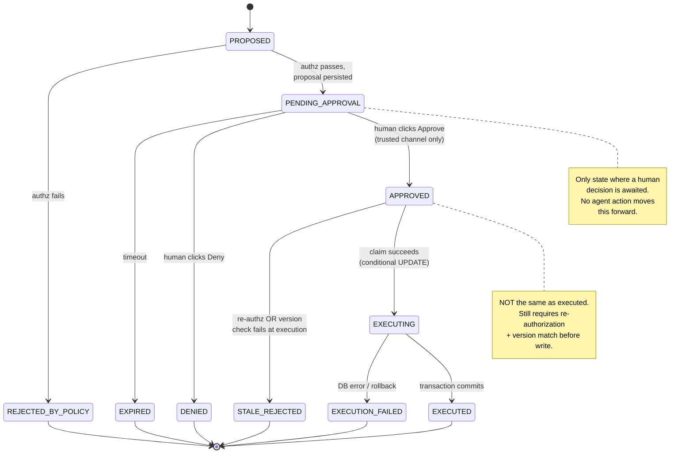
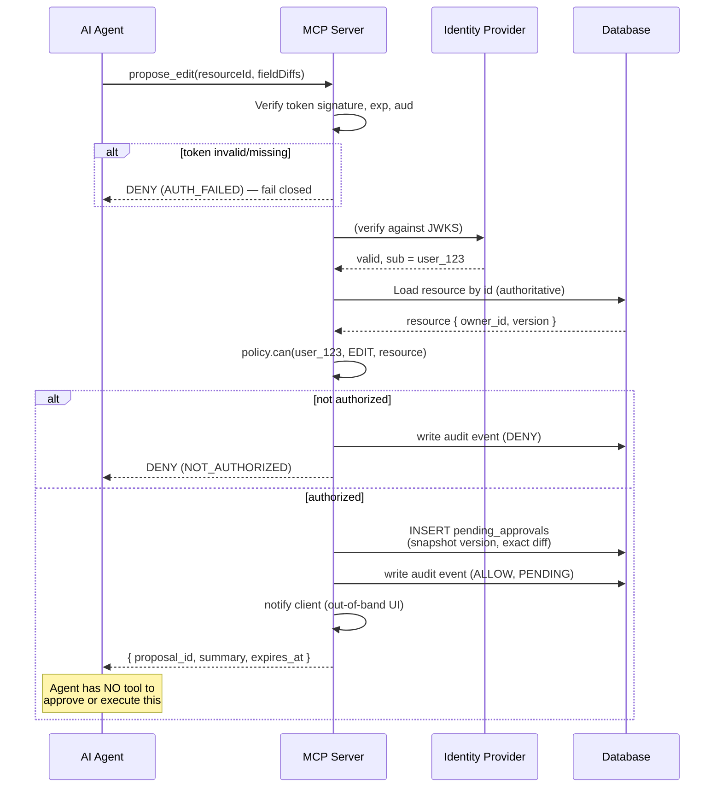
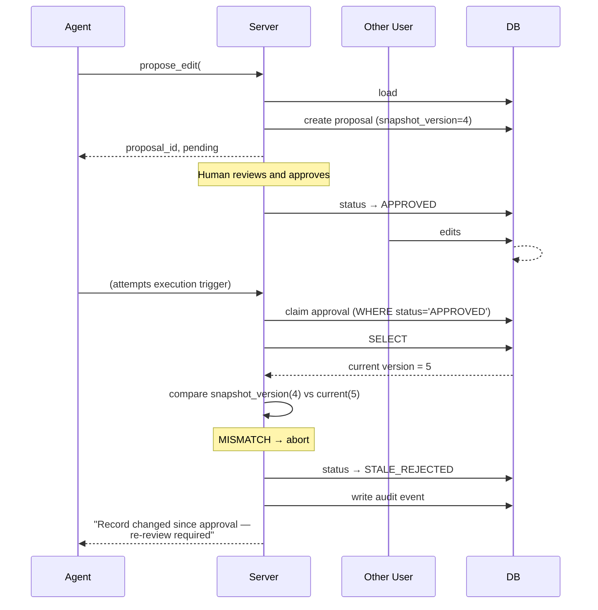
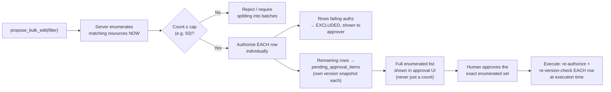

Here are the key parts of the architecture as Mermaid diagrams — trust boundaries, the approval state machine, auth/authz flow, and the race-condition sequence are the ones worth seeing visually.

**1. Trust boundaries & data flow**

```mermaid
flowchart TB
    subgraph untrusted["🔴 UNTRUSTED ZONE"]
        Agent["AI Agent (LLM)"]
        Client["MCP Client"]
        Agent -->|tool call| Client
    end

    subgraph boundary1["Trust Boundary 1: MCP Ingress"]
        Ingress["Transport handling<br/>Correlation ID<br/>Rate limiting<br/>Schema validation"]
    end

    subgraph boundary2["Trust Boundary 2: Auth"]
        Auth["Verify OIDC token<br/>Derive user_id from TOKEN only"]
    end

    subgraph app["🟡 APPLICATION LAYER (semi-trusted, server-controlled)"]
        Policy["Policy / Authorization Engine"]
        Proposal["Proposal Engine<br/>(builds exact diff)"]
        Human["🟢 Human Approval Gate<br/>(out-of-band, agent cannot satisfy)"]
        Reauth["Re-Authorization<br/>+ Version Check"]
        Service["Service Layer<br/>(transactions)"]
    end

    subgraph db["🟢 TRUSTED ZONE"]
        Repo["Repository / DB Access<br/>(parameterized, versioned)"]
        Audit["Append-only Audit Log"]
        PG[("PostgreSQL<br/>least-privilege role, RLS")]
    end

    Client -->|MCP transport| Ingress
    Ingress --> Auth
    Auth --> Policy
    Policy --> Proposal
    Proposal --> Human
    Human --> Reauth
    Reauth --> Service
    Service --> Repo
    Repo --> PG
    Service --> Audit
    Audit --> PG

    style untrusted fill:#3a1414,stroke:#c0392b
    style app fill:#3a3414,stroke:#d4ac0d
    style db fill:#143a1e,stroke:#27ae60
    style boundary1 fill:#2a2a2a,stroke:#888
    style boundary2 fill:#2a2a2a,stroke:#888
```

**2. Approval state machine**

**3. Authentication + authorization flow (per request)**

**4. Race condition: the scenario you flagged, and how it's stopped**

**5. Bulk operation containment**

The throughline across all five: the agent's reach ends at "create a proposal." Everything past that — the approve click, the re-check, the write — happens in a zone the agent has no tool to touch.