Absolutely. The easiest way to understand the architecture is to view it as **one security pipeline**, where the AI agent is deliberately kept outside the trust boundary.

## 1. Complete architecture

```mermaid
flowchart TB

    USER["👤 Human User"]

    subgraph UNTRUSTED["UNTRUSTED SIDE"]
        AGENT["🤖 AI Agent"]
        CLIENT["MCP Client<br/>Claude Desktop / Web / Custom"]
    end

    subgraph TRUST["TRUSTED APPLICATION SECURITY BOUNDARY"]

        MCP["MCP Server / Transport"]

        AUTH["Authentication<br/>OIDC / OAuth"]
        IDENTITY["Trusted Identity Context<br/>user_id / tenant_id / session_id"]

        VALIDATE["Input Validation<br/>Schema + normalization"]

        POLICY["Policy Engine"]
        AUTHZ["Authorization"]
        OWNER["Ownership Check"]

        PROPOSAL["Action Proposal Engine"]
        APPROVAL["Approval Service"]

        REVALIDATE["Execution-Time<br/>Revalidation"]

        SERVICE["Domain Service"]

        TX["Transaction Manager"]
        CONC["Optimistic Concurrency"]

        REPO["Repository"]
    end

    subgraph DATABASE["DATABASE TRUST BOUNDARY"]
        DB["PostgreSQL"]
    end

    subgraph AUDIT["SECURITY OBSERVABILITY"]
        AUDIT["Append-Only Audit"]
        SIEM["SIEM / Monitoring"]
        ALERT["Security Alerts"]
    end

    USER --> CLIENT
    AGENT --> CLIENT
    CLIENT --> MCP

    MCP --> AUTH
    AUTH --> IDENTITY
    IDENTITY --> VALIDATE

    VALIDATE --> POLICY
    POLICY --> AUTHZ
    AUTHZ --> OWNER

    OWNER --> PROPOSAL
    PROPOSAL --> APPROVAL

    APPROVAL -. "Show exact action" .-> USER
    USER -. "Explicit approval" .-> APPROVAL

    APPROVAL --> REVALIDATE

    REVALIDATE --> SERVICE
    SERVICE --> TX
    TX --> CONC
    CONC --> REPO
    REPO --> DB

    AUTHZ --> AUDIT
    OWNER --> AUDIT
    PROPOSAL --> AUDIT
    APPROVAL --> AUDIT
    REVALIDATE --> AUDIT
    SERVICE --> AUDIT

    AUDIT --> SIEM
    SIEM --> ALERT

    AGENT -. "❌ No DB access" .-> DB
    AGENT -. "❌ No approval authority" .-> DB
    AGENT -. "❌ No direct SQL" .-> DB
```

The most important thing here is that:

```text
AI Agent
   │
   │ REQUEST
   ▼
MCP Server
   │
   ▼
Security Pipeline
   │
   ▼
Human Approval
   │
   ▼
Security Revalidation
   │
   ▼
Database Transaction
```

The agent **never becomes an authority**.

---

# 2. What the AI agent actually controls

The AI can say:

```text
"I want to edit employee 123."

"I want salary to change from 10L → 15L."

"Reason: user requested salary correction."
```

But it cannot say:

```text
user_id = owner_123
approved = true
authorized = true
execute = true
```

Those values are either ignored or derived by the server.

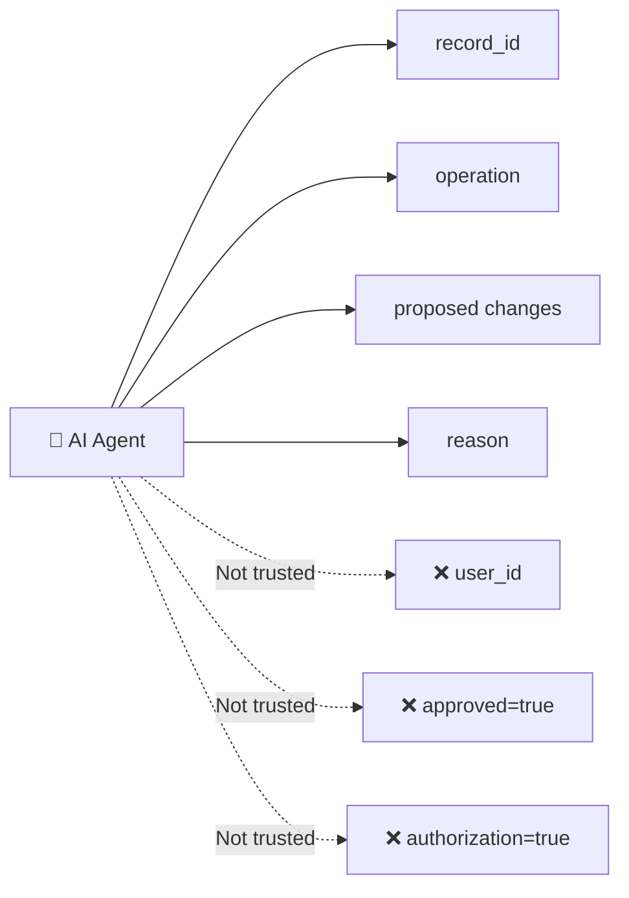

The server obtains:

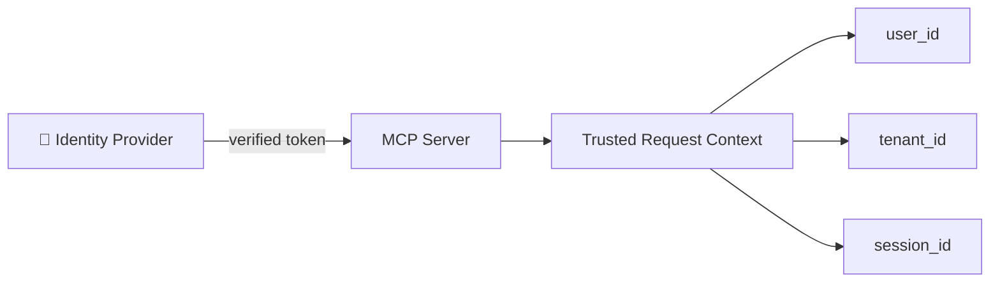

So if the agent sends:

```json
{
  "user_id": "user_789"
}
```

the server doesn't use it.

The trusted context might actually be:

```text
user_id = user_123
tenant_id = tenant_456
session_id = session_999
```

---

# 3. The most important flow: EDIT

Suppose the agent wants:

```text
EDIT employee #123
salary: ₹10L → ₹15L
```

The complete flow is:

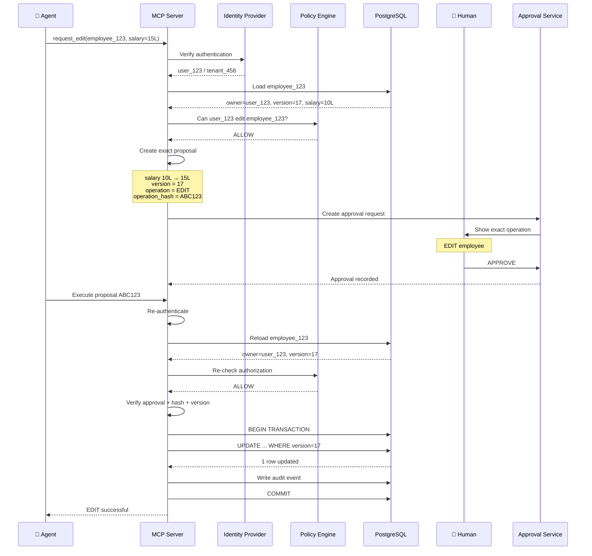

Notice something very important:

**Authorization happens twice.**

First:

```text
When proposal is created
```

and again:

```text
Immediately before execution
```

That protects against changes occurring between approval and execution.

---

# 4. Why approval needs an exact operation hash

Suppose the user approved:

```text
Employee #123
Salary:
₹10L → ₹15L
```

Represent the operation canonically:

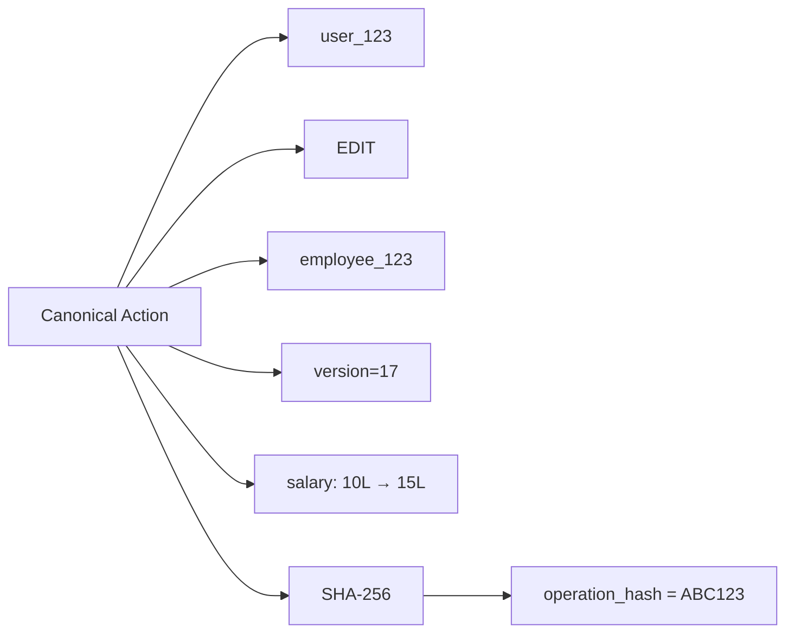

The approval is bound to:

```text
ABC123
```

Now suppose the agent changes it:

```text
₹10L → ₹50L
```

The hash becomes:

```text
XYZ999
```

Therefore:

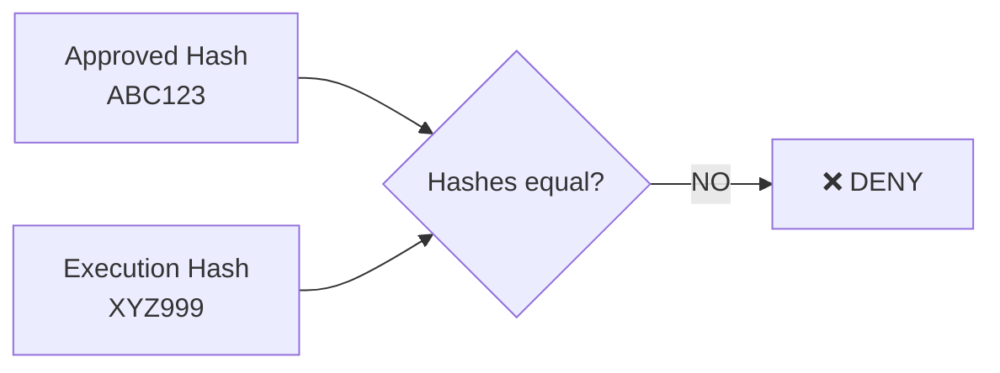

This prevents:

```text
User approves A
Agent executes B
```

---

# 5. Approval state machine

This is probably the **most important diagram** for your implementation.

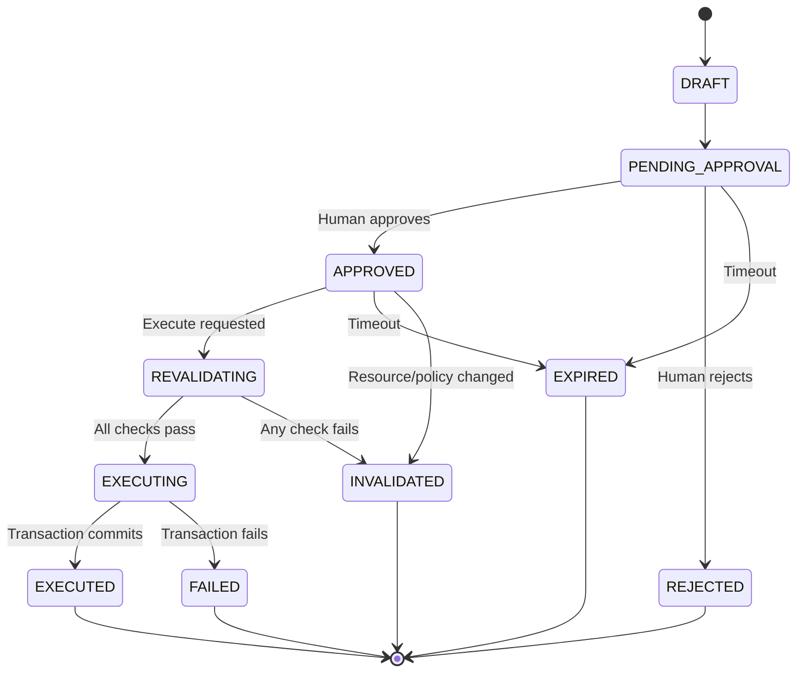

The critical rule is:

```text
APPROVED
   ↓
REVALIDATING
   ↓
EXECUTING
```

**Never:**

```text
APPROVED
   ↓
EXECUTING
```

without revalidation.

---

# 6. What happens during REVALIDATING?

The server checks everything again.

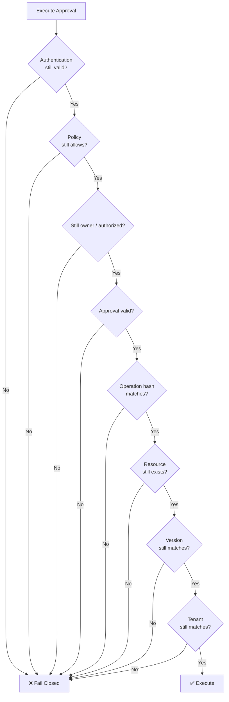

**Any failure = no mutation.**

---

# 7. Race condition protection

Consider:

```text
Agent creates approval
       ↓
record version = 17

Human approves
       ↓
Another user edits record
       ↓
record version = 18

Agent executes old approval
```

Without concurrency control:

```text
❌ Agent could overwrite the other user's changes.
```

With optimistic concurrency:

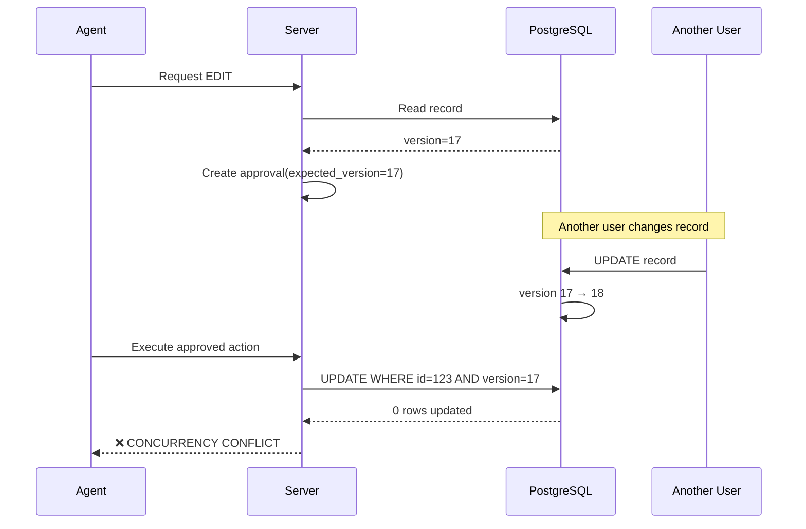

The old approval is invalidated.

The user must review the **new state**.

---

# 8. Database architecture

This boundary should be extremely simple:

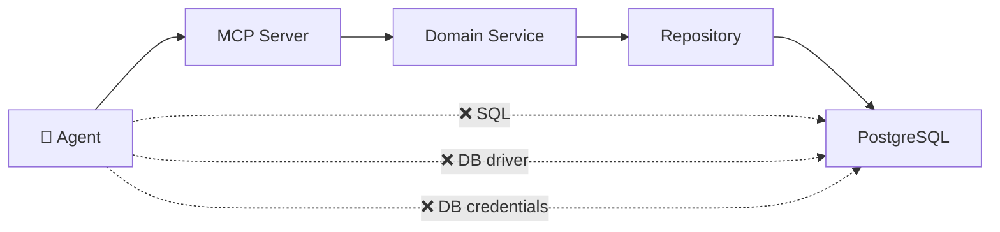

The agent should have **zero database capability**.

Even if the agent says:

> "Run this SQL directly."

there is no tool capable of doing it.

---

# 9. Authorization + ownership

The important distinction is:

```text
Authentication
    =
"Who are you?"

Authorization
    =
"Are you allowed to do this?"

Ownership
    =
"Do you own THIS particular object?"
```

Diagram:

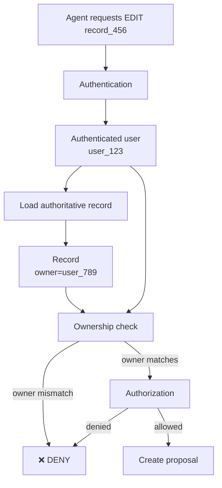

The agent cannot change:

```text
user_123
```

to:

```text
user_789
```

because the identity comes from the authentication layer.

---

# 10. Audit architecture

Every security decision should generate correlated events.

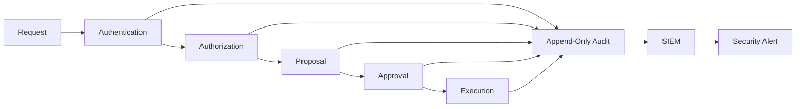

For one operation you might get:

```text
request_id = req_123

AUTHENTICATION_SUCCESS
AUTHORIZATION_ALLOWED
OWNERSHIP_ALLOWED
ACTION_PROPOSED
APPROVAL_REQUESTED
APPROVAL_APPROVED
EXECUTION_STARTED
EXECUTION_SUCCEEDED
```

Everything is correlated using:

```text
request_id
proposal_id
approval_id
execution_id
```

---

# 11. Tamper-resistant audit

Don't rely solely on:

```text
Application → normal database table
```

because a compromised application could potentially modify its own audit history.

Better:

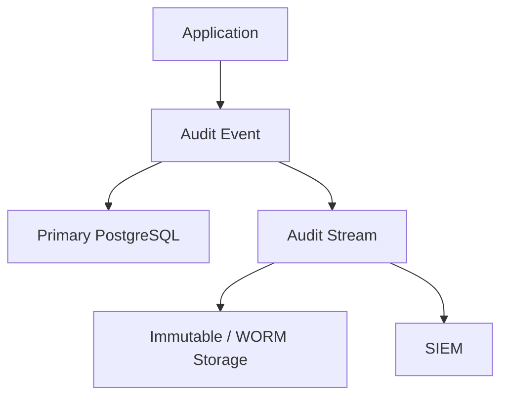

For stronger integrity you can additionally hash-chain events:

```text
H0 = hash(event0)

H1 = hash(event1 + H0)

H2 = hash(event2 + H1)

H3 = hash(event3 + H2)
```

So modifying an old event breaks the chain.

---

# 12. Bulk operations

I would **not expose these initially**:

```text
delete_all()
update_many()
delete_many()
```

Instead:

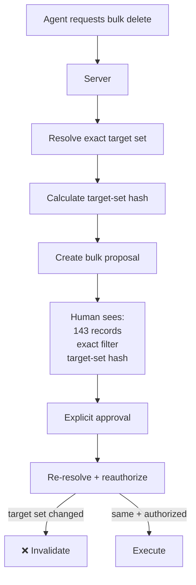

An approval for:

```text
DELETE employee #123
```

must **never** authorize:

```text
DELETE employees WHERE department='Engineering'
```

---

# 13. Threat model in one diagram

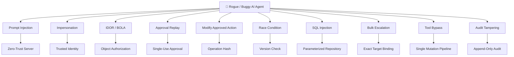

---

# 14. The single mutation gateway

This is another architectural rule I'd strongly recommend.

Every mutation must pass through:

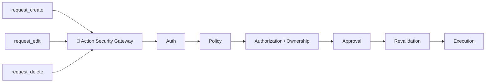

This prevents the classic mistake:

```text
edit_record()
      ↓
security checks

BUT

raw_update()
      ↓
database
```

The second path destroys the entire security model.

---

# 15. Final mental model

Think of the architecture as **three authorities**:

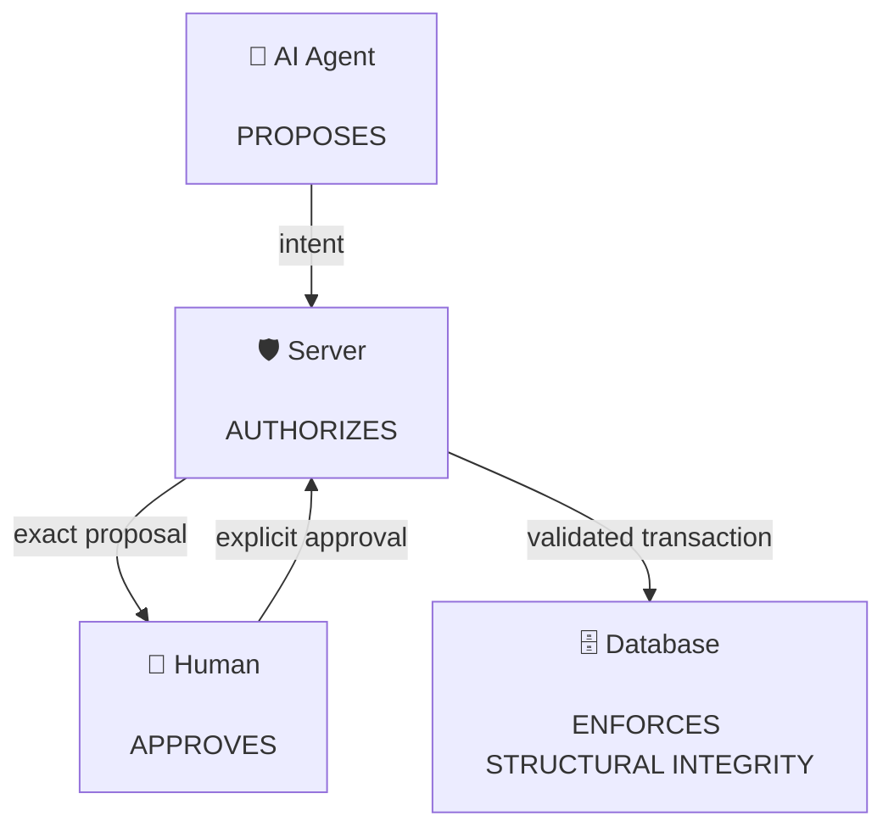

The AI says:

> **"I want to do X."**

The server says:

> **"According to identity, ownership, policy and current state, X is allowed."**

The human says:

> **"I approve this exact X."**

The server checks everything **again**.

Then PostgreSQL performs:

> **"This exact authorized transaction."**

That is the core zero-trust MCP architecture.

### The invariant to remember

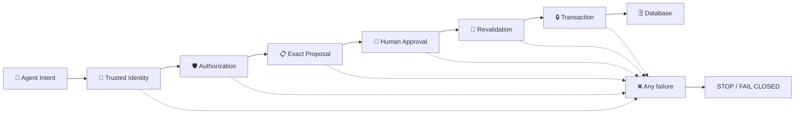

**If any box fails, the database mutation does not happen.**
