Absolutely. The easiest way to understand the architecture is to follow **one mutation from the AI agent all the way to PostgreSQL**.

## 1. The big picture

The most important rule is:

> **The AI agent can request an operation, but it can never directly perform the operation.**

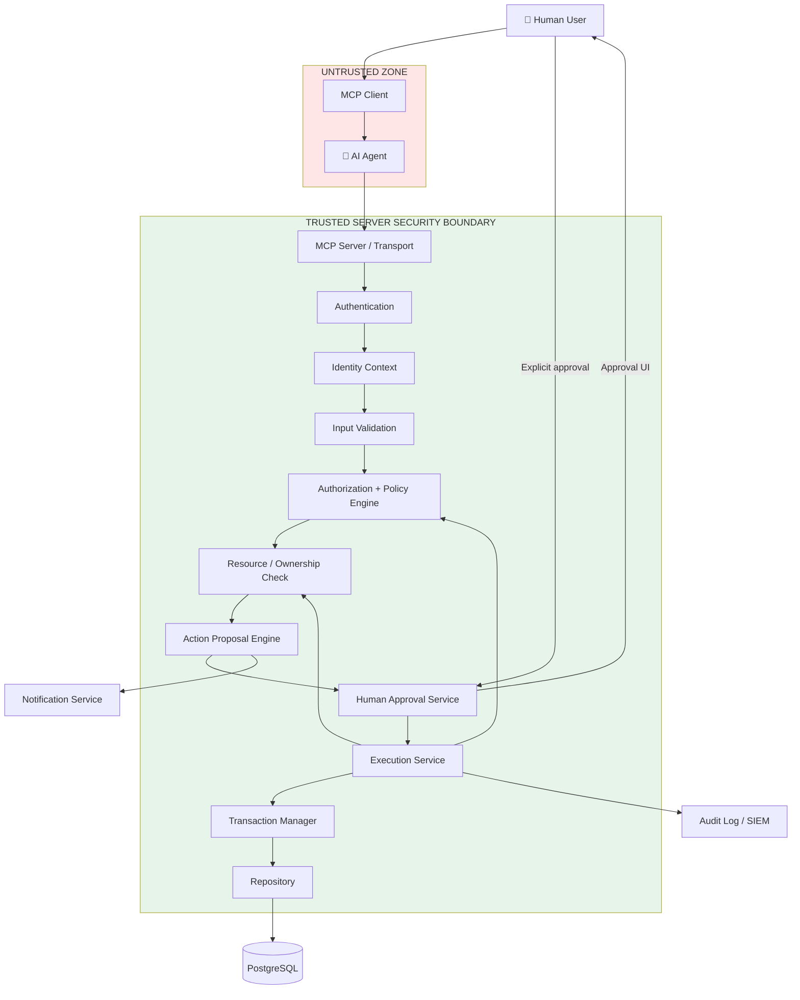

### Notice the critical property

There is **no**:

```text
AI → PostgreSQL
```

There is also no:

```text
AI → Repository
AI → SQL
AI → Execution Service
```

The agent only reaches the **request/proposal side** of the system.

---

# 2. What happens when the agent wants to EDIT something?

Suppose the user says:

> "Increase employee #123's salary to ₹15 lakh."

The agent might produce:

```text
EDIT employee 123
salary: ₹10L → ₹15L
```

But this is **only intent**.

It is not authorization.

It is not approval.

It is not execution.

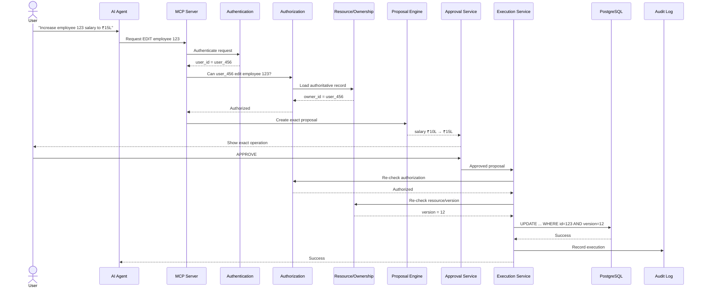

The **double authorization check** is intentional.

---

# 3. Why do we authorize twice?

This is one of the most important parts.

Imagine:

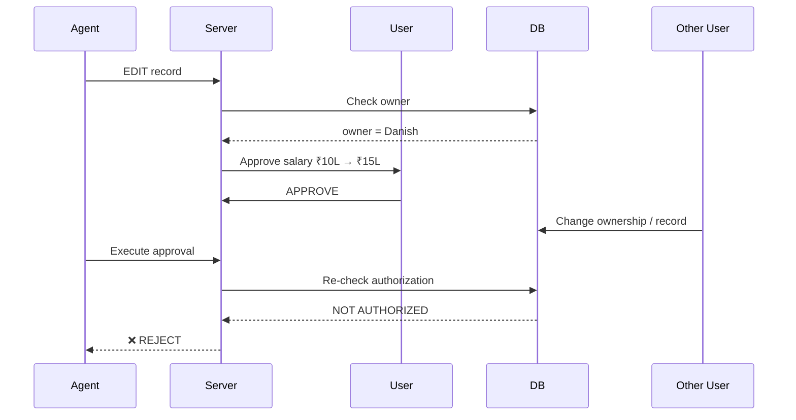

If you only authorized during proposal creation, you have a **TOCTOU** problem:

```text
Time T1:
    User authorized

Time T2:
    Something changed

Time T3:
    Mutation executes
```

Therefore:

> **Approval does not freeze authorization.**

Authorization must still be valid at execution time.

---

# 4. Approval is NOT a Boolean

This is unsafe:

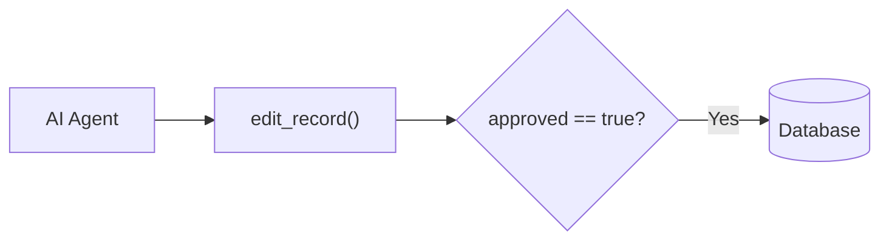

Because the agent can simply send:

```json
{
  "id": "123",
  "salary": 1500000,
  "approved": true
}
```

The agent has effectively approved its own action.

Instead:

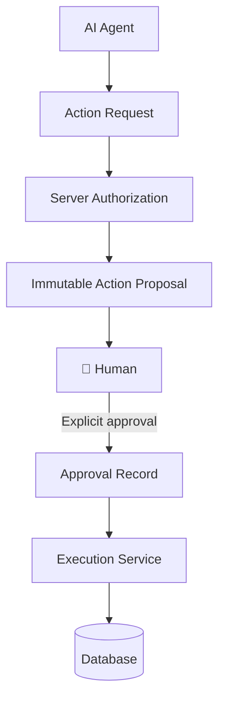

The approval comes from a **separate trusted channel controlled by the user**.

---

# 5. Approval must be bound to the exact operation

Suppose the proposal is:

```text
Employee: 123
Operation: EDIT
Field: salary
Old: ₹10L
New: ₹15L
Version: 12
```

The system creates something conceptually like:

```text
Action Proposal

proposal_id = proposal_abc

operation = EDIT
resource = employee:123
changes = salary: 10L → 15L
resource_version = 12
user = user_456
expires_at = ...
```

You can think of it as:

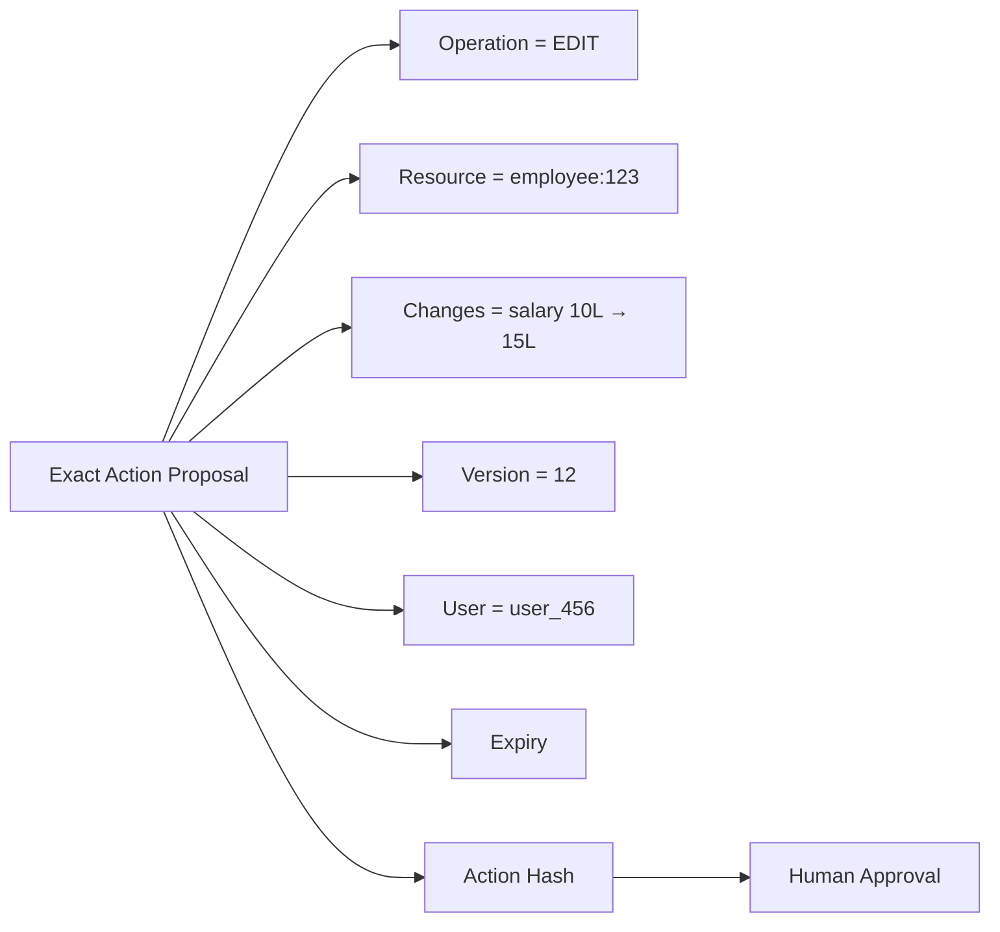

The approval effectively means:

> "I approve **this exact proposal**."

Not:

> "I approve whatever the agent does next."

---

# 6. What if the agent changes the action after approval?

Suppose the user approves:

```text
₹10L → ₹15L
```

Then the agent tries:

```text
₹10L → ₹50L
```

The server reconstructs the proposed operation and compares it against the approved action.

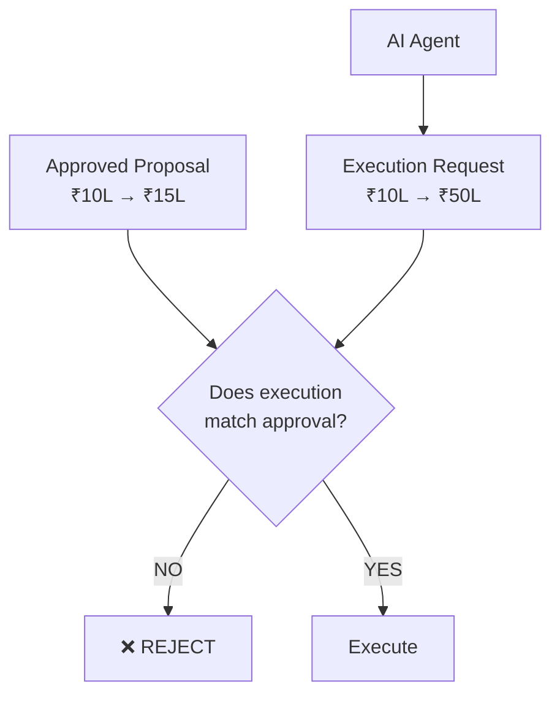

Therefore:

```text
Approved action ≠ Requested execution
                         ↓
                      REJECT
```

---

# 7. The approval state machine

This is probably the **most important diagram in the entire architecture**.

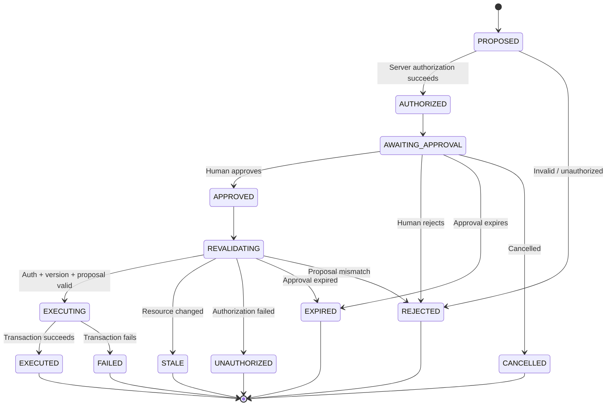

Notice:

```text
APPROVED
   ↓
REVALIDATING
   ↓
EXECUTING
```

There is **no direct**:

```text
APPROVED → EXECUTED
```

because approval alone is insufficient.

---

# 8. The state machine is server-owned

The AI should not be able to do this:

```json
{
  "proposal_id": "123",
  "status": "APPROVED"
}
```

Instead:

```mermaid
flowchart LR
    A["AI Agent"]

    A -->|"request"| S["Server"]

    S --> P["PROPOSED"]
    P --> AU["AUTHORIZED"]
    AU --> WAIT["AWAITING_APPROVAL"]

    WAIT --> USER["👤 User"]

    USER -->|"Approve"| SERVER["Trusted Server"]

    SERVER --> APPROVED["APPROVED"]
    APPROVED --> REVALIDATE["REVALIDATING"]
    REVALIDATE --> EXEC["EXECUTING"]
```

The user action causes the transition.

The agent cannot manufacture that transition.

---

# 9. Database architecture

The database should be behind several layers.

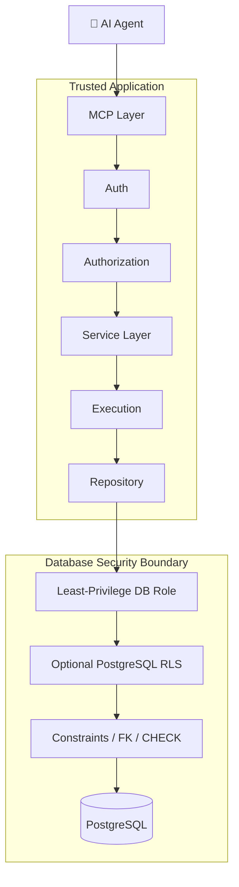

The agent never receives:

```text
DATABASE_URL
DB password
PostgreSQL credentials
SQL connection
database driver
```

---

# 10. Database mutation with optimistic locking

Suppose:

```text
record_id = 123
version = 12
```

The approved operation contains:

```text
expected_version = 12
```

The actual SQL should conceptually behave like:

```sql
UPDATE employees
SET salary = 1500000,
    version = version + 1
WHERE id = 123
  AND version = 12;
```

Then:

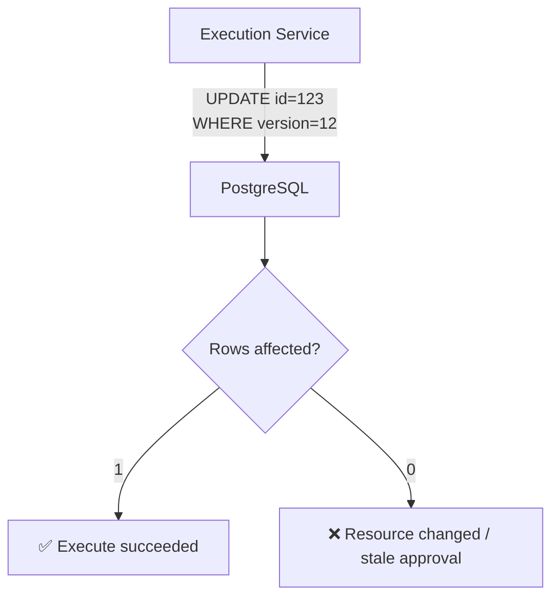

This prevents:

```text
Approved version: 12
Current version: 13
```

from silently overwriting the newer data.

---

# 11. CREATE / EDIT / DELETE should all pass through the same security boundary

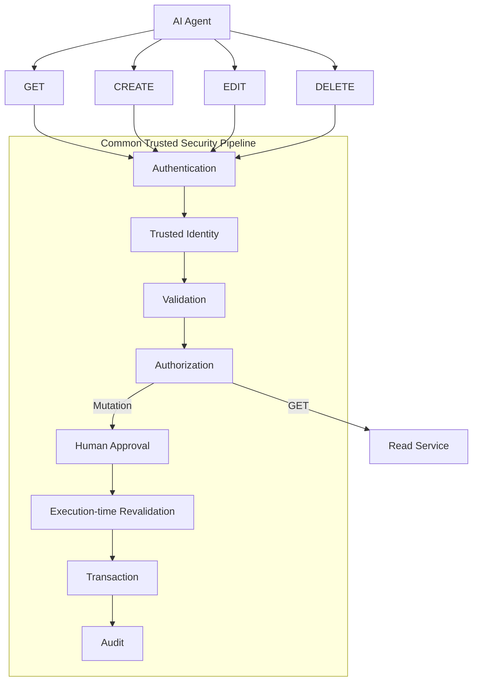

This is important because an agent might otherwise discover:

```text
edit_employee()
```

is protected, but:

```text
update_employee_fields()
```

is not.

The architecture must ensure **no alternate tool provides a bypass**.

---

# 12. Audit architecture

Every mutation should create a trustworthy audit trail.

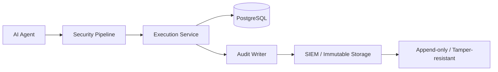

Conceptually an audit event could contain:

```text
request_id
proposal_id
approval_id
authenticated_user
client/session
operation
resource
authorization_result
ownership_result
resource_version
approval_timestamp
execution_timestamp
result
failure_reason
```

But **not**:

```text
password
access_token
API key
session cookie
unnecessary sensitive data
```

---

# 13. Multi-tenant protection

For a B2B SaaS system, you also need:

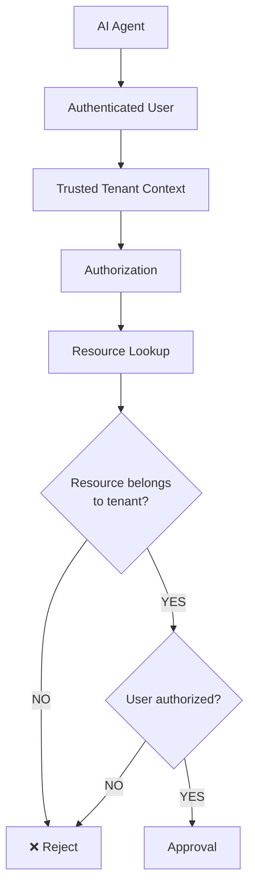

The agent should never be able to say:

```json
{
  "tenant_id": "company_B"
}
```

and thereby switch tenants.

Tenant identity should come from the authenticated principal/session.

---

# 14. The complete security model

Put everything together:

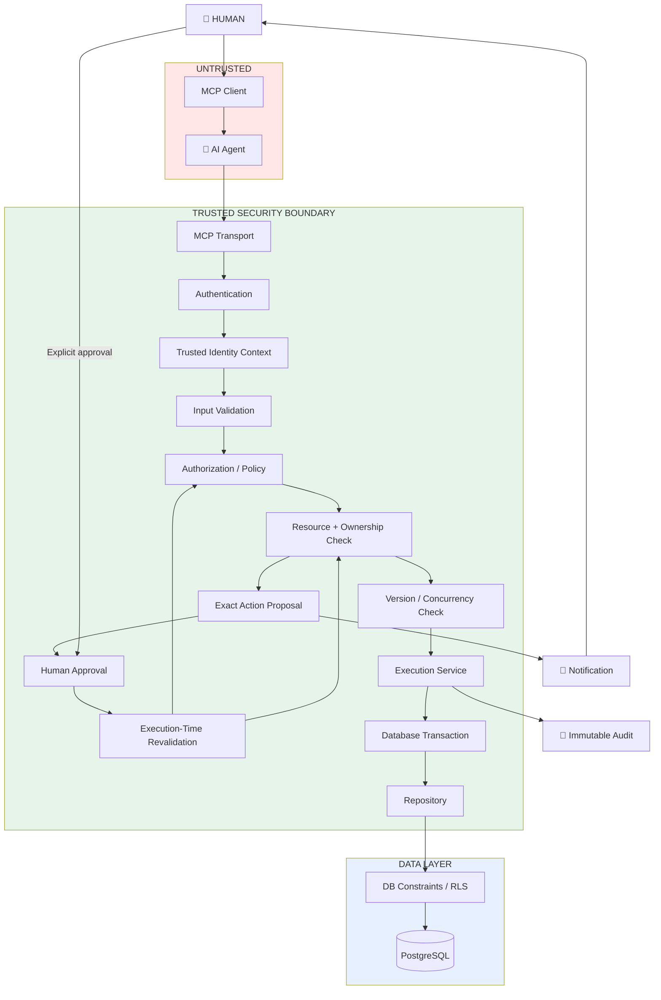

## The key idea

Think of the AI as a **very powerful but untrusted employee**.

It can say:

> "I want to change employee #123."

But it cannot say:

> "I am user #456."

It cannot say:

> "I am authorized."

It cannot say:

> "The user approved this."

It cannot say:

> "Execute this SQL."

And it cannot say:

> "Ignore the previous security checks."

The trusted server independently determines all of those things.

---

## 15. The security invariant in one diagram

Ultimately, you want this:

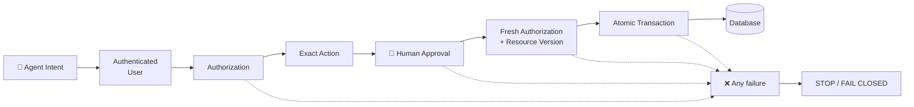

The fundamental rule is:

**No successful path exists from `Agent Intent` to `Database` unless every security gate succeeds.**

That's the architecture I'd implement around.
